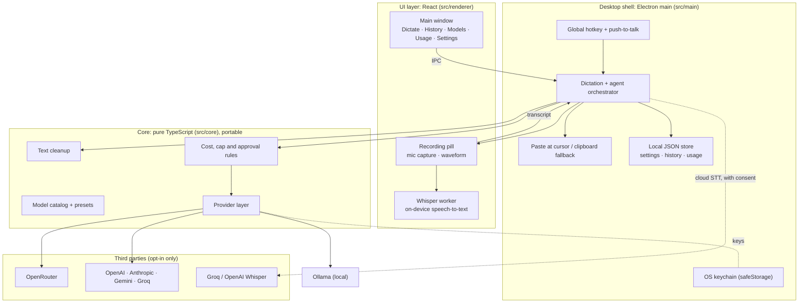

# Yowly: architecture, milestones, iOS plan

## Stack

**Electron + React + TypeScript**, built with electron-vite.

| Option | For | Against |
|---|---|---|
| **Electron (chosen)** | Mature global hotkeys, paste, keychain. Chromium gives WebGPU/WASM for on-device Whisper. Fastest path to a working app. | ~150 MB install, higher memory. |
| Tauri 2 | Small and light. Has an iOS target. | Needs Rust for every native piece. Thinner hotkey/paste ecosystem. WebView differences between OSes. |
| React Native (+ Windows/macOS) | One UI for mobile and desktop. | Desktop targets are weak for global hotkeys and text insertion. |

Decision rule: the desktop shell is replaceable; `src/core` is not tied to it.

## Layers

**Rules that keep it portable**

- `src/core` imports no Electron, Node or DOM APIs. It only uses `fetch`, `FormData`, `Blob` and the Anthropic SDK.
- API keys are decrypted only in the main process. The UI knows only "key present: yes/no".
- The UI talks to the shell through one small bridge (`invoke`, `send`, `on`). A mobile app implements the same calls natively.
- Every model call passes through `decide()` in `core/cost.ts`. There is no other path to a paid provider.

## Data flow of one dictation

1. Hotkey → main sets phase `recording`, shows pill without focus, registers `Esc`.
2. Pill records the chosen mic. On stop it decodes to 16 kHz mono, rejects clips under 0.4 s or silent ones.
3. Speech-to-text: Whisper in a web worker (default) or cloud Whisper via main (needs consent + key + budget).
4. Main runs `cleanup()`, saves to history (per retention), then inserts or opens the review editor.
5. Optional agent action: consent → estimate → cap/approval gate → provider → real usage logged.

## What studying Wispr Flow's installer showed

Static triage of `WisprFlowInstaller.exe` only (not run, nothing decompiled or copied):

- It is a 6 MB signed .NET 10 NativeAOT bootstrapper, not the app. It downloads the real payload, checks it against a manifest signature, restricts download hosts, and reports install events to PostHog. *(read in strings and PE metadata)*
- Its build path contains `desktop\windows-helper-app`, so the product ships a separate native Windows helper beside the main desktop app. *(read in PDB path; the helper's job is inferred)*

Takeaways for Yowly: keep OS integration (hotkeys, insertion) in a small native layer behind an interface, and ship a small signed installer that verifies what it downloads. The app payload itself was not available for analysis.

## MVP milestones

| # | Milestone | Done when |
|---|---|---|
| M0 | **Prototype (this repo)** | Hotkey → local transcript → cleanup → insert/copy works. Agent actions, cap, history, settings work. |
| M1 | Dictation quality | Streaming partial transcript in the pill. Voice-activity trimming. Model bundled or served from an app protocol so it caches in packaged builds. GPU (WebGPU) path. Restore previous clipboard after paste. |
| M2 | Packaging | Signed installers for Windows and macOS (electron-builder), auto-update, launch at login, macOS mic + accessibility permission onboarding, strict CSP. |
| M3 | Agent polish | Streaming responses, live OpenRouter catalog browser, per-app default transformation, custom vocabulary. |
| M4 | Trust | SQLite + encrypted history, export/delete tools, privacy policy, opt-in analytics and crash reports. |
| M5 | Beta | 50 external users, measure time-to-text and correction rate, fix top issues. |
| M6 | iOS | See below. |

## Mobile / iOS readiness

**Reused as-is:** all of `src/core` (cleanup, cost, catalog, providers, settings schema, error catalog), the design tokens, the mascot SVG, the screen structure.

**Rebuilt natively:**

| Desktop | iOS equivalent |
|---|---|
| Global hotkey | Custom keyboard extension with a mic key, plus Action Button / Shortcuts / Siri intent |
| Paste at cursor | `textDocumentProxy.insertText` from the keyboard extension |
| Whisper in web worker | WhisperKit (Core ML) or Apple `SpeechAnalyzer` on device |
| safeStorage | iOS Keychain with a shared access group (app + keyboard) |
| JSON files | App Group container (SQLite) |
| Tray + pill | Live Activity / Dynamic Island while recording |

**Constraints to design for now**

- A keyboard extension cannot record audio by itself. Standard pattern: the keyboard opens the main app, which records in the background (audio background mode) and hands the text back through the App Group. Needs "Allow Full Access".
- Keyboard extensions have a small memory limit, so transcription and model calls run in the main app, never in the extension.
- UI: React Native + Expo for the app screens, Swift for the keyboard extension and audio.
- BYO API keys keep Yowly outside in-app purchase rules. If Yowly ever sells credits or a subscription for digital features, it must use StoreKit.

**Work now that pays off later:** keep core pure, keep the bridge small, keep settings/history as plain serializable data, avoid desktop-only assumptions in copy ("press the hotkey" comes from settings, not hard-coded).
